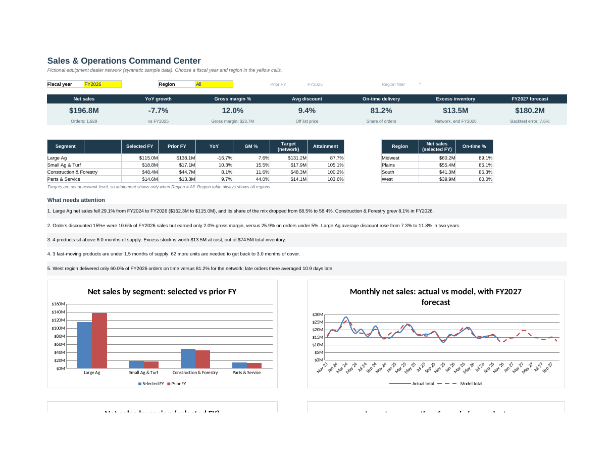

# Sales & Operations Command Center

An end-to-end Excel analytics project for a **fictional 12-dealer equipment network**: sales analysis, inventory and delivery operations, statistics, a backtested forecast, what-if scenarios, an interactive dashboard, and VBA automation (pivot tables, slicers, reports).



> **Data notice.** All data is synthetic. "Heartland Equipment" and its dealers are fictional. The data was generated to resemble the situation farm and construction equipment makers face (a large-ag downturn, margin pressure, inventory right-sizing). It is **not** John Deere data, and no number here describes any real company.

## The business problem

Equipment dealer networks have to answer the same questions every month:

- Where is demand falling and where is it growing?
- Is discounting buying volume, or just giving away margin?
- Is inventory in the right machines, or is cash tied up in the wrong ones?
- Are customers getting their equipment on time?
- What should we plan for next year, and how wrong might we be?

This workbook answers all five from one set of order data, and ends with recommended actions that carry a dollar value.

## What is in the workbook

| Sheet | Purpose |
|---|---|
| `Dashboard` | KPI cards, segment and region tables, four charts, top issues. Fiscal year and region dropdowns. |
| `Findings` | Seven plain-language insights with recommended actions and dollar value. The text is built from formulas, so it updates with the data. |
| `Sales_Analysis` | Segment and region trends, target attainment, discount bands, customer mix, dealer scorecard with flags, product Pareto (ABC). |
| `Ops_Analysis` | Months of supply, overstock and stockout flags, suggested reorders, on-time delivery by region and segment. |
| `Statistics` | Order-value distribution, correlations, trend regression, outlier months. |
| `Forecast` | FY2027 forecast by segment (seasonal index x linear trend) with error measured on an FY2026 holdout. |
| `What_If` | Four scenarios (baseline, cycle recovery, downside, custom) for volume, discount and cost. |
| `Macro_Guide` | How to enable and use the macros. |
| `Forecast_Model`, `Sales_Data`, `Dim_Product`, `Dim_Dealer`, `Targets` | Calculation engine, order data (5,684 rows, Nov 2023 to Oct 2026), lookups and plan numbers. |

The fiscal year runs November to October and is labelled by the year it ends in.

## Sample results (on the synthetic data)

| Finding | Result |
|---|---|
| Large Ag trend | Net sales fell 29.1% from FY2024 to FY2026 ($162.3M to $115.0M) while Construction & Forestry grew 8.1% in FY2026 |
| Discounting | Orders discounted 15%+ earn about 2.0% gross margin versus 25.9% on orders under 5% |
| Discount ceiling | A 12% ceiling would recover about $1.2M a year, assuming those orders still close |
| Excess inventory | $13.5M at cost sits above the 6-month overstock threshold; about $1.1M a year in carrying cost (assumes an 8% rate) |
| Stockout risk | 3 fast-moving products are under 1.5 months of supply; 62 more units restore 3 months of cover |
| Delivery | West region on time for 60.0% of orders versus 81.2% for the network |
| Aftermarket | Parts & Service is 7.4% of sales but 27.1% of gross margin |
| Forecast | FY2027 net sales of $180.2M, range $166.4M to $193.9M; holdout backtest error 7.6% |

The sample data was designed to contain these patterns, so the value shown here is the **method**, not the numbers. Every figure above is a live formula in the workbook.

## Methods

- **Data model:** fact table `tblSales` joined to product and dealer dimensions with `INDEX/MATCH`; named ranges make formulas readable.
- **Forecast:** per-segment seasonal index multiplied by a linear trend fitted to deseasonalized sales, built from first principles in formulas. Validated by training on FY2024-25 and predicting FY2026 (MAPE). The low and high cases are forecast plus or minus the backtest error, a practical band rather than a statistical confidence interval.
- **Inventory:** months of supply = on hand / average monthly demand, with configurable overstock and stockout thresholds.
- **Statistics:** Pearson correlation, skewness, SLOPE/INTERCEPT/RSQ trend regression, z-score outlier months.

### Known limits

- A linear trend extends the past; it cannot see a cycle turning. The `What_If` sheet lets you overlay a management view.
- Inventory is a single end-of-year snapshot with no on-order or in-transit stock.
- Correlation is not causation. Discounts rose as the market fell, so the cycle confounds the discount and volume relationship.
- Thresholds (6 months overstock, 1.5 months stockout, 8% carrying cost, 12% discount ceiling) are illustrative assumptions in yellow input cells.

## VBA automation

The macros live in [`vba/modCommandCenter.bas`](vba/modCommandCenter.bas) and are embedded in the `.xlsm`.

| Macro | What it does |
|---|---|
| `BuildPivotReports` | Builds 7 pivot tables on 6 sheets, 3 pivot charts and 4 slicers (Fiscal Year, Region, Segment, Customer Type) sharing one pivot cache, so one slicer click filters every report |
| `RefreshAllReports` | Refreshes all pivots and formulas after new orders are pasted in |
| `ResetAllFilters` | Clears every slicer and resets the dashboard |
| `ExportDashboardPDF` | Saves the Dashboard and Findings as a dated PDF |
| `CreateDealerReports` | Creates one workbook per dealer (orders plus KPI summary) |
| `RunDataQualityCheck` | Logs duplicates, blanks, formula errors, out-of-range values and impossible dates |
| `DiscountExceptionReport` | Lists every order at or above a discount level you choose |
| `EmailKpiSummary` | Opens an Outlook draft with the KPIs and top findings; never sends |
| `BuildControlPanel` | Creates a Control_Panel sheet with a button per macro |

**Status:** the macro code and the embedded VBA project were generated programmatically without Excel and have **not been test-run in Excel yet**. Expect to possibly fix small issues on first run. Pull requests and issues are welcome.

## How to use

1. Download `Sales_Operations_Command_Center.xlsm`.
2. On Windows, right-click the file > Properties > tick **Unblock**.
3. Open it, click **Enable Content**, and answer **Yes** to build the pivots, or run `BuildPivotReports` from Alt+F8.
4. Change the yellow cells to explore: dashboard year and region, thresholds on `Ops_Analysis`, scenarios on `What_If`.
5. To use your own data, paste rows into the `Sales_Data` table and run `RefreshAllReports`.

If Excel strips the embedded macros, import `vba/modCommandCenter.bas` (Alt+F11 > File > Import File), then run `BuildPivotReports`.

Requires Excel 2013 or later on Windows. Pivot, slicer and email macros need desktop Excel (and Outlook for the email draft).

## Repository layout

```
Sales_Operations_Command_Center.xlsm   the workbook (macro-enabled)
vba/modCommandCenter.bas               the VBA module
data/sales_data_sample.csv             the synthetic orders, with calculated columns
docs/dashboard.png                     dashboard preview
src/build_workbook.py                  Python (openpyxl) script that generates the data and workbook
src/embed_vba.py                       script used to embed the VBA project (LibreOffice UNO)
```

`build_workbook.py` regenerates the workbook with a fixed random seed. It needs `openpyxl`; recalculating formulas needs LibreOffice.

## Skills demonstrated

Business problem framing, data modelling, KPI design, Excel formulas at scale (about 76,000), pivot tables and slicers, descriptive and inferential statistics, time-series forecasting with backtesting, inventory analytics, scenario analysis, dashboard design, VBA automation, and documenting assumptions.

## License

Released under the MIT License. The data is synthetic and free to use.

## Author

Pradeep Karra - data analytics, business intelligence and AI solutions.
